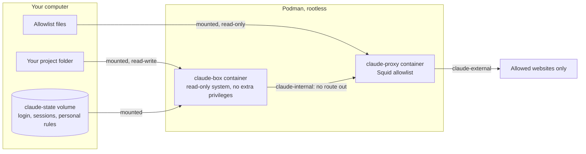

# claude-sandbox

A rootless Podman setup for running Claude Code on your own computer. Claude sees only the project folder you start it from, and its internet access goes through an allowlist proxy that you control.

## What it is

Claude Code can edit files and run commands. That is what makes it useful, and it is also what makes mistakes and tricked instructions (for example, from a malicious web page or repository) costly. This project runs Claude Code inside a container with several independent layers of protection, so a single failure does not give it your whole computer.

You start it with one command from any project folder:

```bash
cd ~/path/to/project
claude-box claude
```

## How it works



- **`claude-box`** is the container where Claude Code runs. It starts from the image built from `image/Containerfile`.
- **`claude-proxy`** is a separate container (Squid). It is the only door out to the internet, and it opens only for the sites on the allowlist.
- The launcher script `bin/claude-box` ties it together: it mounts your project, picks the network, and applies the safety options.

## What is protected

| Protection | What it stops |
|---|---|
| Rootless Podman | A container escape landing as root on your computer |
| Only the project folder is shared | Claude seeing the rest of your computer |
| No extra privileges, process and memory limits | Programs gaining special powers or freezing your machine |
| Internal network plus allowlist proxy | Data leaving to sites you didn't approve |
| Managed Claude settings | Reading secret files such as `.env`; switching permission prompts off |
| Read-only filesystem | Changing system files inside the container |

The guide explains each one: see [Step 9](docs/09-hardening.md) for a summary table.

## Requirements

Install these on the **host** machine.

| Requirement | Version | Why it is needed |
|---|---|---|
| Ubuntu | 24.04 LTS (tested) | Host OS. Other Linux distributions with Podman should work but are untested |
| Podman | 4.9 or newer | Runs the containers without root |
| uidmap | any | Lets rootless Podman map user IDs into the container |
| git | any | Clones this repo |
| Claude account | | A Claude subscription or Anthropic Console account to log in to Claude Code |
| Internet access | | Downloads the base image and Claude Code during the build |

The container image brings its own Ubuntu 26.04 base, Claude Code, git, ripgrep, jq and Python 3, so you do **not** install those on the host.

## Quick start

This is the short version

Read the [step-by-step guide](docs/README.md) once, because it explains every command and how to check each step.

```bash
# 1. Install the requirements, then get the repo
sudo apt update && sudo apt install -y podman uidmap git
git clone <REPO_URL> ~/claude-sandbox
cd ~/claude-sandbox

# 2. Build the image Claude runs in
podman build -t claude-box:dev image/

# 3. Create the networks and your own allowlist file
podman network create --internal claude-internal
podman network create claude-external
[ -f proxy/allowlist.local.txt ] || printf '# Your own allowed sites (ignored by git), one per line.\n' > proxy/allowlist.local.txt

# 4. Build and start the proxy
podman build -t claude-proxy:dev proxy/
podman run -d --name claude-proxy \
  --network claude-internal --network claude-external \
  --cap-drop=all --security-opt=no-new-privileges \
  -v "$HOME/claude-sandbox/proxy/allowlist.txt":/etc/squid/allowlist.txt:ro \
  -v "$HOME/claude-sandbox/proxy/allowlist.local.txt":/etc/squid/allowlist.local.txt:ro \
  claude-proxy:dev

# 5. Install the launcher
chmod +x ~/claude-sandbox/bin/claude-box
mkdir -p ~/.local/bin
ln -sf ~/claude-sandbox/bin/claude-box ~/.local/bin/claude-box

# 6. Use it from any project folder. The first run asks you to log in.
cd ~/path/to/your/project
claude-box claude
```

If the first login fails through the proxy, run it once with `claude-box --open claude`. Your login is saved, so later runs can use the default restricted mode.

## Where your data lives

Only **two** places keep anything after a session ends:

| Where in the container | What it is | Defined in `bin/claude-box` by |
|---|---|---|
| `/workspace/<project>` | Your real project folder, shared from your computer | `-v "$PROJECT":"/workspace/$NAME"` |
| `~/.claude` | Your login, session history and personal `CLAUDE.md` (the `claude-state` volume) | `-v claude-state:/home/claude/.claude` |

Everything else is temporary or locked:

- The rest of the home folder (`/home/claude`) and `/tmp` are wiped when the session ends (`--tmpfs`).
- The system folders (`/usr`, `/etc`, `/bin` and so on) are read-only (`--read-only`).

`~/.claude` sits inside the home folder, but it is a separate volume stored on your computer, so it is the one exception. [Step 9](docs/09-hardening.md) explains this with a diagram.

## Daily use

| I want to | Run |
|---|---|
| Work on a project with Claude | `cd ~/path/to/project && claude-box claude` |
| Continue an earlier session | `claude-box claude -r` |
| Open a shell in the sandbox | `claude-box` |
| Use the whole web for this session only | `claude-box --open claude` |
| Allow a website | Add it to `proxy/allowlist.local.txt`, then `podman restart claude-proxy` |
| Change the image, the policy file, or `image/CLAUDE.md` | Edit it, then `podman build -t claude-box:dev image/` |

## Modes and the allowlist

- **Restricted mode** (the default): the container reaches the internet only through the proxy, and only for sites on the allowlist.
- **Open mode** (`--open`): full internet access, with a warning at every start. Use it for projects you trust, and only while you need it.

The proxy reads two lists. `proxy/allowlist.txt` comes with the repo and holds the Claude Code hosts. `proxy/allowlist.local.txt` is yours, is ignored by git, and holds the sites you add. Details in [Step 7](docs/07-allowlist-proxy.md).

## Maintenance

| Task | When | How |
|---|---|---|
| Back up `claude-state` | Before reinstalling your OS, and now and then | See "Back up your sessions" below |
| Update Claude Code | When a new release is out | Check the version, then rebuild: [Step 3](docs/03-build-image.md) |
| Free disk space | Occasionally | `podman image prune` removes old, untagged images |
| See what exists | Any time | `podman ps -a`, `podman images`, `podman volume ls` |
| Review the proxy log | Now and then | `podman exec claude-proxy tail -n 50 /var/log/squid/access.log` |

### Back up your sessions

Your session history (what `claude -r` lists), your login, and your personal `CLAUDE.md` all live in the `claude-state` volume, so backing it up is how you keep them across a reinstall or a new computer.

```bash
# Close any claude-box session first, then back up.
# The backup holds your login token, so keep the folder private.
mkdir -p ~/backups && chmod 700 ~/backups
podman volume export claude-state -o ~/backups/claude-state-$(date +%F).tar
chmod 600 ~/backups/claude-state-*.tar
```

```bash
# Restore on a fresh machine, into a new empty volume.
podman volume create claude-state
podman volume import claude-state ~/backups/claude-state-YYYY-MM-DD.tar
```

- **Keep the backup private.** It contains your login token. Never commit it or share it.
- **To see your old sessions again**, keep each project's folder name the same. Claude files sessions by folder path, and the launcher mounts every project at `/workspace/<folder name>`.
- **Try a restore once** before you rely on it, into a test volume (for example `claude-state-test`), and check it with a one-off container.

> **Warning:** never run `podman volume prune` or `podman system prune --volumes`. They delete every volume that no container is using right now, and `claude-state` counts as unused whenever no session is open. `podman image prune` is safe.

## The step-by-step guide

The [guide](docs/README.md) walks you through the setup in order: install Podman, get the repo, build the image, install the launcher, log in, isolate the network, build the proxy, switch to restricted mode, review the hardening, and review the global `CLAUDE.md`. Each step ends with a "Done when" checklist.

## What this does not protect against

- **Allowlisted sites can still carry data out.** A site that accepts uploads (GitHub, paste sites, cloud storage) is a possible way out, so list only what you need.
- **Your login token is inside the container.** Anything running in a `claude-box` container can read it, so only run Claude on projects you trust.
- **Open mode removes the network protection** for as long as you use it.
- **`CLAUDE.md` is guidance, not enforcement.** The hard limits are the settings, the network and the filesystem.
- **No sandbox is perfect.** A flaw in the container runtime or the kernel could still be exploited, which is one reason the container runs rootless.

## What is not in this repo

Logins, API keys, tokens, `.env` files, your personal allowlist (`proxy/allowlist.local.txt`), and your personal rules (`~/.claude/CLAUDE.md` in the volume). See `.gitignore`.

## License

MIT. See [LICENSE](LICENSE).