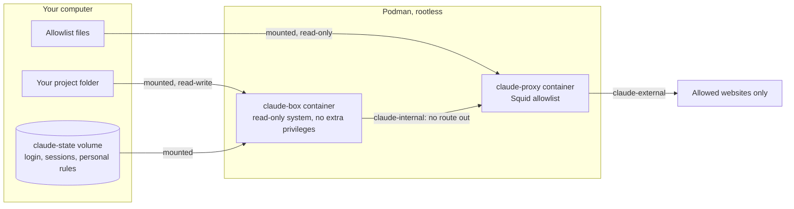

# claude-sandbox

[](LICENSE)


A rootless Podman setup for running Claude Code on your own computer. Claude sees only the project folder you start it from, and its internet access goes through an allowlist proxy that you control.

**Status:** a personal project that I use myself, with best-effort support. Tested with Claude Code 2.1.311 on Ubuntu 24.04 (Podman 4.9). Issues are welcome.

[Quick start](#quick-start) · [What it protects against, and what it doesn't](#what-it-protects-against-and-what-it-doesnt) · [Step-by-step guide](docs/README.md)

## Why this exists

AI coding agents can edit files and run commands for you, which is what makes them useful. It also means that anything able to steer the agent can act as you. The realistic scenario is **prompt injection**: instructions hidden in a repository, a README, a web page, or a tool's output that the agent reads and follows as if you had written them.

An agent running directly on your computer can reach everything your user can: SSH keys, cloud credentials, browser data, every other project. Unless you restrict it, it can also send any of that to any website. Permission prompts help, but they are one layer, and they depend on you catching every risky request. This project adds layers that don't.

`claude-sandbox` runs Claude Code inside a rootless Podman container. You start it with one command from any project folder:

```bash
cd ~/path/to/project
claude-box claude
```

## Compared with running Claude Code directly

| | Claude Code run directly (default settings) | claude-sandbox |
|---|---|---|
| Files Claude can reach | Everything your user can read and write: home folder, SSH keys, other projects | Only the project folder you start it from, plus its own `~/.claude` volume |
| Network | Whatever your computer can reach | Only the sites on your allowlist (restricted mode) |
| Runs as | Your user | An unprivileged user inside a rootless container |
| Permission prompts | Yes | Yes, with bypass mode locked off |

Claude Code also has optional built-in sandbox settings. This project is a separate approach: a container boundary that you can inspect and test yourself, and that does not depend on Claude Code's own settings being right.

## What it protects against, and what it doesn't

### Protects against

| What could go wrong | What stops it here |
|---|---|
| Claude reading files outside the project, such as SSH keys or other projects | Only the project folder is shared with the container |
| Data being sent to a site you didn't approve | An internal network with no route out, plus an allowlist proxy (name lookups are closed off too) |
| A container escape landing as root on your computer | Rootless Podman, no extra privileges |
| A runaway program freezing your machine | Process and memory limits |
| Reading secret files such as `.env`, or switching permission prompts off | Managed Claude settings baked into the image |
| Changing system files inside the container | A read-only filesystem |

[Step 9](docs/09-hardening.md) has a summary table with where each protection is defined.

### Does not protect against

- **Prompt injection itself.** Claude can still be tricked. The layers above limit how much damage that can do.
- **Everything inside the project folder.** Claude can read and change every file in the project you start it from, so use version control.
- **Allowlisted sites can still carry data out.** A site that accepts uploads (GitHub, paste sites, cloud storage) is a possible way out, so list only what you need.
- **Your login token is inside the container.** Anything running in a `claude-box` container can read it, so only run Claude on projects you trust.
- **Open mode removes the network protection** for as long as you use it.
- **`CLAUDE.md` is guidance, not enforcement.** The hard limits are the settings, the network and the filesystem.
- **No sandbox is perfect.** A flaw in the container runtime or the kernel could still be exploited, which is one reason the container runs rootless.

## How it works



- **`claude-box`** is the container where Claude Code runs. It starts from the image built from `image/Containerfile`.
- **`claude-proxy`** is a separate container (Squid). It is the only door out to the internet, and it opens only for the sites on the allowlist.
- The launcher script `bin/claude-box` ties it together: it mounts your project, picks the network, and applies the safety options.

## Requirements

Install these on the **host** machine.

| Requirement | Version | Why it is needed |
|---|---|---|
| Ubuntu | 24.04 LTS (tested) | Host OS. Other Linux distributions with Podman should work but are untested |
| Podman | 4.9 or newer | Runs the containers without root |
| uidmap | any | Lets rootless Podman map user IDs into the container |
| git | any | Clones this repo |
| Claude account | | A Claude subscription or Anthropic Console account to log in to Claude Code |
| Internet access | | Downloads the base image and Claude Code during the build |

The container image brings its own Ubuntu 26.04 base, Claude Code, git, ripgrep, jq and Python 3, so you do **not** install those on the host.

## Quick start

This is the short version. Read the [step-by-step guide](docs/README.md) once, because it explains every command and how to check each step.

```bash
# 1. Install the requirements, then get the repo
sudo apt update && sudo apt install -y podman uidmap git
git clone <REPO_URL> ~/claude-sandbox
cd ~/claude-sandbox

# 2. Build the image Claude runs in
podman build -t claude-box:dev image/

# 3. Create the networks and your own allowlist file
podman network create --internal claude-internal
podman network create claude-external
[ -f proxy/allowlist.local.txt ] || printf '# Your own allowed sites (ignored by git), one per line.\n' > proxy/allowlist.local.txt

# 4. Build and start the proxy
podman build -t claude-proxy:dev proxy/
podman run -d --name claude-proxy \
  --network claude-internal --network claude-external \
  --cap-drop=all --security-opt=no-new-privileges \
  -v "$HOME/claude-sandbox/proxy/allowlist.txt":/etc/squid/allowlist.txt:ro \
  -v "$HOME/claude-sandbox/proxy/allowlist.local.txt":/etc/squid/allowlist.local.txt:ro \
  claude-proxy:dev

# 5. Install the launcher
chmod +x ~/claude-sandbox/bin/claude-box
mkdir -p ~/.local/bin
ln -sf ~/claude-sandbox/bin/claude-box ~/.local/bin/claude-box

# 6. Use it from any project folder. The first run asks you to log in.
cd ~/path/to/your/project
claude-box claude
```

If the first login fails through the proxy, run it once with `claude-box --open claude`. Your login is saved, so later runs can use the default restricted mode.

## Where your data lives

Only **two** places keep anything after a session ends:

| Where in the container | What it is | Defined in `bin/claude-box` by |
|---|---|---|
| `/workspace/<project>` | Your real project folder, shared from your computer | `-v "$PROJECT":"/workspace/$NAME"` |
| `~/.claude` | Your login, session history and personal `CLAUDE.md` (the `claude-state` volume) | `-v claude-state:/home/claude/.claude` |

Everything else is temporary or locked:

- The rest of the home folder (`/home/claude`) and `/tmp` are wiped when the session ends (`--tmpfs`).
- The system folders (`/usr`, `/etc`, `/bin` and so on) are read-only (`--read-only`).

`~/.claude` sits inside the home folder, but it is a separate volume stored on your computer, so it is the one exception. [Step 9](docs/09-hardening.md) explains this with a diagram.

## Daily use

| I want to | Run |
|---|---|
| Work on a project with Claude | `cd ~/path/to/project && claude-box claude` |
| Continue an earlier session | `claude-box claude -r` |
| Open a shell in the sandbox | `claude-box` |
| Use the whole web for this session only | `claude-box --open claude` |
| Allow a website | Add it to `proxy/allowlist.local.txt`, then `podman restart claude-proxy` |
| Change the image, the policy file, or `image/CLAUDE.md` | Edit it, then `podman build -t claude-box:dev image/` |

## Modes and the allowlist

- **Restricted mode** (the default): the container reaches the internet only through the proxy, and only for sites on the allowlist.
- **Open mode** (`--open`): full internet access, with a warning at every start. Use it for projects you trust, and only while you need it.

The proxy reads two lists. `proxy/allowlist.txt` comes with the repo and holds the Claude Code hosts. `proxy/allowlist.local.txt` is yours, is ignored by git, and holds the sites you add. Details in [Step 7](docs/07-allowlist-proxy.md).

## Maintenance

| Task | When | How |
|---|---|---|
| Back up `claude-state` | Before reinstalling your OS, and now and then | See "Back up your sessions" below |
| Update Claude Code | When a new release is out | Check the version, then rebuild: [Step 3](docs/03-build-image.md) |
| Update this repo | When you want fixes | `git pull`, then rebuild the image if `image/` changed, and the proxy if `proxy/` changed |
| Free disk space | Occasionally | `podman image prune` removes old, untagged images |
| See what exists | Any time | `podman ps -a`, `podman images`, `podman volume ls` |
| Review the proxy log | Now and then | `podman exec claude-proxy tail -n 50 /var/log/squid/access.log` |

### Back up your sessions

Full details, including encryption, a safe restore test, and what never to prune, are in [Step 11](docs/11-maintenance.md).

Your session history (what `claude -r` lists), your login, and your personal `CLAUDE.md` all live in the `claude-state` volume, so backing it up is how you keep them across a reinstall or a new computer.

```bash
# Close any claude-box session first, then back up.
# The backup holds your login token, so keep the folder private.
mkdir -p ~/backups && chmod 700 ~/backups
podman volume export claude-state -o ~/backups/claude-state-$(date +%F).tar
chmod 600 ~/backups/claude-state-*.tar
```

```bash
# Restore on a fresh machine, into a new empty volume.
podman volume create claude-state
podman volume import claude-state ~/backups/claude-state-YYYY-MM-DD.tar
```

- **Keep the backup private.** It contains your login token. Never commit it or share it.
- **Also copy `proxy/allowlist.local.txt`** to a safe place. It holds your own allowed sites, and git ignores it.
- **To see your old sessions again**, keep each project's folder name the same. Claude files sessions by folder path, and the launcher mounts every project at `/workspace/<folder name>`.
- **Try a restore once** before you rely on it, into a test volume (for example `claude-state-test`), and check it with a one-off container.

> **Warning:** never run `podman volume prune` or `podman system prune --volumes`. They delete every volume that no container is using right now, and `claude-state` counts as unused whenever no session is open. `podman image prune` is safe.

## The step-by-step guide

The [guide](docs/README.md) walks you through the setup in order: install Podman, get the repo, build the image, install the launcher, log in, isolate the network, build the proxy, switch to restricted mode, review the hardening, review the global `CLAUDE.md`, and keep it all maintained and backed up. Each step ends with a "Done when" checklist.

## What is not in this repo

Logins, API keys, tokens, `.env` files, your personal allowlist (`proxy/allowlist.local.txt`), and your personal rules (`~/.claude/CLAUDE.md` in the volume). See `.gitignore`.

## License

MIT. See [LICENSE](LICENSE).

## Disclaimer

This is an independent project. It is not affiliated with, endorsed by, or supported by Anthropic. Claude and Claude Code are products of Anthropic.