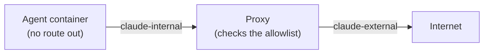

# Cut the container off from the network

## Description

Right now a container started from your image can reach the whole internet. This step proves that, then creates a Podman **internal network** and shows that a container on it cannot reach anything outside.

It is the foundation for Step 7, where a small proxy will let through only the websites you choose. Nothing about your daily workflow changes here: you only run one-off test commands.

## Why this matters

Claude's permission prompts are one layer of protection. A network limit is a second layer. If a malicious project tricked Claude into running something harmful, there would be nowhere to send your files or your login token.

Anthropic's own reference setup uses a firewall *inside* the container, which needs an extra privilege (`NET_ADMIN`). This project avoids that and keeps the container unprivileged. The container simply has no way out, and a separate proxy container is the only door.

## The plan across Steps 6 to 8



1. **Step 6 (this step):** create the internal network, `claude-internal`, which has no route to the outside world.
2. **Step 7:** build a proxy container that sits on **both** networks and forwards traffic only for allowed domains.
3. **Step 8:** switch the launcher to the internal network, so restricted mode is the default.

## Before you start

- Step 3 is done: the image `claude-box:dev` exists.

## Key terms

- **Network**: a virtual cable that connects containers to each other and, sometimes, to the internet.
- **Internal network**: a network whose containers can talk to each other but have no route to anything outside it.
- **DNS**: the internet's phone book. It turns a name such as `example.com` into an address. Connecting to that address is a separate step.
- **Proxy**: a middleman. Programs ask it to fetch things for them, and it decides what to allow. You build it in Step 7.

## 6.1 See the problem: open internet access

```bash
# Run a one-off container from your image and fetch a web page.
#   --rm                 delete the container when it finishes
#   curl -sS             stay quiet, but still show errors
#   -o /dev/null         throw away the page itself
#   -w '%{http_code}\n'  print only the HTTP status code
# Anything after the image name replaces the image's default "bash" command.
podman run --rm claude-box:dev \
  curl -sS -o /dev/null -w '%{http_code}\n' https://example.com
```

**Expected:** `200`. The container can reach any website.

## 6.2 Check the network backend

```bash
# Rootless Podman should use "netavark" for custom networks.
podman info --format '{{.Host.NetworkBackend}}'
```

**Expected:** `netavark`.

## 6.3 Create the internal network

```bash
# Create a network named "claude-internal".
# --internal means containers on it can talk to each other,
# but have no route to the outside world.
podman network create --internal claude-internal

# List the networks. Expected: "podman" (the default) and "claude-internal".
podman network ls

# Confirm the internal flag. Expected: "internal": true
podman network inspect claude-internal | grep -i internal
```

## 6.4 Prove it is isolated

```bash
# Same container, same command, but attached to the internal network.
#   --network claude-internal   use the isolated network
#   -m 8                        give up after 8 seconds
podman run --rm --network claude-internal claude-box:dev \
  curl -sS -m 8 -o /dev/null -w '%{http_code}\n' https://example.com
```

**Expected:** an error, and **no** `200`. Any of these is fine:

- `Failed to connect to example.com port 443 ...: Could not connect to server`
- `Could not resolve host: example.com`
- a timeout message

Now check it isn't just the name lookup that is blocked, by connecting to a raw address:

```bash
# 1.1.1.1 is a public DNS server's address. No name lookup is needed.
podman run --rm --network claude-internal claude-box:dev \
  curl -sS -m 8 -o /dev/null -w '%{http_code}\n' https://1.1.1.1
```

**Expected:** an error such as `Failed to connect to 1.1.1.1 port 443 after 0 ms: Could not connect to server`, and no `200`. Failing after `0 ms` means there is no route at all.

## 6.5 Check that the default network is unaffected

```bash
# Without --network, the container uses the default network, so it still works.
# Expected: 200
podman run --rm claude-box:dev \
  curl -sS -m 8 -o /dev/null -w '%{http_code}\n' https://example.com
```

This is why nothing about your daily workflow changes yet. The launcher only uses the internal network from Step 8 on.

## 6.6 A note about DNS

In the 6.4 name test, you may have seen `Failed to connect to example.com` and not `Could not resolve host`. That means the name **was** looked up, and only the connection failed. On an internal network, name lookups can still pass through to your computer's DNS service.

That is a very small leak: data could in theory be smuggled out inside lookups for made-up names. It does not matter for this step. The launcher closes it in restricted mode (it gives the container a DNS setting that goes nowhere), and Step 8 shows how to check it.

## Keep the network

You will use `claude-internal` in Steps 7 and 8, so leave it in place. It holds no settings, so if you ever want to undo this step you can remove it and recreate it later with the same command:

```bash
# Removes the network. It fails if a container is still using it.
podman network rm claude-internal
```

## Troubleshooting

| Symptom | Fix |
|---|---|
| 6.2 shows `cni` instead of `netavark` | Report the output. The network backend would need to be switched |
| `podman network create` fails | Report the exact error and the output of `podman --version` |
| 6.4 still prints `200` | The container is not on the internal network. Make sure `--network claude-internal` comes **before** the image name |
| 6.1 does not print `200` | Check your internet connection, then retry |
| `network already exists` | The network was created earlier. Check it with `podman network ls`, and continue |
