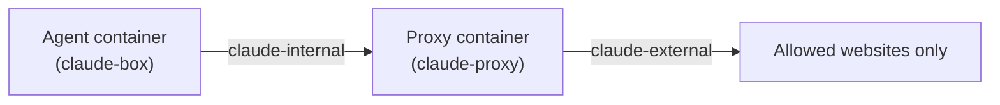

# Build the allowlist proxy

## Description

Build and run a small proxy container that forwards HTTPS traffic **only** to the websites listed in a file you control. You test it with one-off commands. The launcher is connected to it in Step 8.

## How the pieces fit



- The agent container stays on `claude-internal`, which has no way out (Step 6).
- The proxy is a **separate container**, built from its own image (`claude-proxy:dev`, from `proxy/Containerfile`). It sits on **both** networks, so it is the only door out, and the door opens only for the websites on the allowlist.
- Keeping them separate means the agent cannot change the allowlist, and you can edit the allowlist and restart the proxy without touching the agent.
- The proxy software is Squid, a long-established proxy. With caching turned off and a short allowlist it typically needs only tens of megabytes of memory, so it adds very little to your computer or server.
- Claude Code speaks the standard HTTP proxy protocol (the `HTTPS_PROXY` variable). It does not support SOCKS proxies.

## Before you start

- Steps 3 and 6 are done: the image `claude-box:dev` and the network `claude-internal` exist.

## Key terms

- **Allowlist**: a list of the only things that are allowed. Everything not on it is refused.
- **Tunnel (CONNECT)**: how HTTPS goes through a proxy. The program asks the proxy to open a pipe to a website, and then talks to the website through it.
- **Squid**: the proxy program used here.

## 7.1 Create the external network

```bash
# A normal network (with internet access) for the proxy's outer side.
podman network create claude-external

# Expected: claude-internal and claude-external (plus the default "podman")
podman network ls
```

## 7.2 Review the proxy files

The files are already in your clone, in the `proxy/` folder. You don't type anything in this section.

### The allowlist: `proxy/allowlist.txt`

```bash
cd ~/claude-sandbox
cat proxy/allowlist.txt
```

It should look like this:

```text
# Domains the agent may reach over HTTPS. One per line.
# "example.com" matches only that name.
# ".example.com" (leading dot) matches example.com AND all its subdomains.

# Claude Code essentials
api.anthropic.com
platform.claude.com
claude.ai

# Documentation sites (uncomment or add the ones you use)
# docs.python.org
# docs.podman.io
```

This is the file **you** edit. Lines starting with `#` are comments and are ignored.

### The proxy rules: `proxy/squid.conf`

```text
http_port 3128
visible_hostname claude-proxy

# Which domains are allowed (read from the allowlist file)
acl allowed_domains dstdomain "/etc/squid/allowlist.txt"

# HTTPS tunnels are made with the CONNECT method, only on port 443
acl SSL_ports port 443
acl CONNECT method CONNECT

# Rules are checked top to bottom; the first match wins
http_access deny CONNECT !SSL_ports
http_access allow CONNECT allowed_domains
http_access deny all

# No caching, logs in files we can read later
cache deny all
access_log stdio:/var/log/squid/access.log
cache_log /var/log/squid/cache.log
pid_filename none
coredump_dir /tmp
```

| Line | Meaning |
|---|---|
| `acl allowed_domains dstdomain "..."` | Defines a group called `allowed_domains`, filled from the allowlist file |
| `acl SSL_ports port 443` | Defines the only port HTTPS tunnels may use |
| `acl CONNECT method CONNECT` | Matches HTTPS tunnel requests |
| `http_access deny CONNECT !SSL_ports` | Refuses tunnels to any port other than 443 |
| `http_access allow CONNECT allowed_domains` | Allows tunnels to allowlisted domains |
| `http_access deny all` | Refuses everything else, including plain HTTP. This is the default-deny line |
| `cache deny all` | Turns caching off. The proxy is only a gatekeeper |

### The image recipe: `proxy/Containerfile`

It does five things: starts from the same Ubuntu image, installs Squid, copies in `squid.conf`, creates a log folder owned by the unprivileged `proxy` user, and starts Squid as that user (`squid -N` keeps it in the foreground, so the container keeps running).

The allowlist is **not** baked into the image. It is mounted from your clone when the container starts, so you can edit it without rebuilding.

## 7.3 Build and run the proxy

```bash
cd ~/claude-sandbox

# Build the proxy image from the proxy/ folder.
podman build -t claude-proxy:dev proxy/

# Run it in the background (-d), attached to BOTH networks.
#   --name claude-proxy                 the name other containers use to find it
#   --network (twice)                   the inner side and the outer side
#   --cap-drop=all, no-new-privileges   the same lockdown as the agent container
#   -v ...:ro                           mount the allowlist from your clone, read-only
podman run -d --name claude-proxy \
  --network claude-internal \
  --network claude-external \
  --cap-drop=all \
  --security-opt=no-new-privileges \
  -v "$HOME/claude-sandbox/proxy/allowlist.txt":/etc/squid/allowlist.txt:ro \
  claude-proxy:dev

# Check that it is running. Expected: claude-proxy with a status of "Up ..."
podman ps --filter name=claude-proxy

# Look at the startup logs. Expected: no FATAL lines
podman logs claude-proxy
```

If you run these again later, remove the old container first with `podman rm -f claude-proxy`, because the name is already taken.

## 7.4 Test it from an agent-style container

Run each test from a one-off container on the **internal** network, which has no direct route out:

```bash
# TEST 1: an allowed domain, through the proxy.
#   -x URL   send the request through this proxy
# Expected: a three-digit HTTP status from Anthropic, for example 404.
podman run --rm --network claude-internal claude-box:dev \
  curl -sS -m 20 -x http://claude-proxy:3128 -o /dev/null -w '%{http_code}\n' https://api.anthropic.com
```

`api.anthropic.com` is an API, not a website, so a `404` for its front page is normal. Any real status proves the tunnel worked.

```bash
# TEST 2: a domain that is NOT on the list, through the proxy.
# Expected: an error like "CONNECT tunnel failed, response 403"
podman run --rm --network claude-internal claude-box:dev \
  curl -sS -m 20 -x http://claude-proxy:3128 -o /dev/null -w '%{http_code}\n' https://example.com
```

```bash
# TEST 3: the same allowed domain WITHOUT the proxy.
# Expected: a failure, because the internal network has no route out.
podman run --rm --network claude-internal claude-box:dev \
  curl -sS -m 10 -o /dev/null -w '%{http_code}\n' https://api.anthropic.com
```

```bash
# TEST 4: read the proxy's access log.
# Expected: an allowed line for api.anthropic.com and a DENIED line for example.com.
podman exec claude-proxy tail -n 5 /var/log/squid/access.log
```

### How to read a log line

```text
1794360427.422    278 10.89.0.3 TCP_TUNNEL/200 4985 CONNECT api.anthropic.com:443 - HIER_DIRECT/160.79.104.10 -
1794360486.962      0 10.89.0.4 TCP_DENIED/403 3391 CONNECT example.com:443 - HIER_NONE/- text/html
```

| Part | Meaning |
|---|---|
| `1794360427.422` | When it happened (seconds since 1970) |
| `278` | How long the connection lasted, in milliseconds |
| `10.89.0.3` | Which container asked |
| `TCP_TUNNEL/200` | **Allowed**: the tunnel was opened |
| `TCP_DENIED/403` | **Blocked**: the site is not on the allowlist |
| `CONNECT api.anthropic.com:443` | The site and port that were requested |

Long durations, around 300000 ms (5 minutes), are normal. Claude keeps its connections open for a while.

## 7.5 Allow a new site

```bash
# 1. Add the domain to the allowlist file.
echo "docs.python.org" >> ~/claude-sandbox/proxy/allowlist.txt

# 2. Restart the proxy so it re-reads the file.
podman restart claude-proxy

# 3. Test it. Expected: a 200, or a redirect code such as 301.
podman run --rm --network claude-internal claude-box:dev \
  curl -sS -m 20 -x http://claude-proxy:3128 -o /dev/null -w '%{http_code}\n' https://docs.python.org
```

If you don't want to keep that entry, delete the line from the file and restart the proxy again. Because you edited a file that comes from the repository, `git status` will list it as modified. That is normal (Step 2 explains what to do if `git pull` complains).

## What needs what

| You change | You need to |
|---|---|
| `proxy/allowlist.txt` | `podman restart claude-proxy` |
| `proxy/squid.conf` or `proxy/Containerfile` | Rebuild the image, then re-create the container: `podman build -t claude-proxy:dev proxy/`, `podman rm -f claude-proxy`, and the `podman run` from 7.3 |

## After a reboot

The proxy container stops when your computer shuts down, but it is **not** deleted. It will be started again by the launcher: from Step 8 on, `claude-box` starts it automatically when it is stopped. If you want to start it by hand, run:

```bash
podman start claude-proxy
```

Don't run the long `podman run` again, because the name is already taken. Your images, networks, and the `claude-state` volume all survive a reboot as well.

## Limits to know about

- **An allowlist is only as tight as its entries.** A site that accepts uploads (GitHub, paste sites, cloud storage) can still carry data out, so list only what you need.
- **Plain `http://` is refused.** Only HTTPS tunnels to allowed sites work.
- **DNS on the internal network.** In Step 6 you saw that name lookups can still pass through. The launcher closes that gap in restricted mode, and Step 8 checks it.

## Troubleshooting

| Symptom | Fix |
|---|---|
| `podman logs claude-proxy` shows a `FATAL` line | Copy the exact line. Squid is strict about configuration and file permissions |
| TEST 1 says `Could not resolve proxy: claude-proxy` | The name lookup between containers failed. Check that `podman ps` shows the proxy, and report the output of `podman inspect claude-proxy --format '{{.NetworkSettings.Networks}}'` |
| TEST 1 fails with `403` | The domain isn't in the allowlist, or the proxy was started before you edited the file. Restart it |
| The proxy can't reach the internet | Check that it is on `claude-external`, and run `podman exec claude-proxy getent hosts api.anthropic.com` |
| "permission denied" for the allowlist in the logs | Run `chmod 644 ~/claude-sandbox/proxy/allowlist.txt` |
| `the container name "claude-proxy" is already in use` | It already exists. Use `podman start claude-proxy`, or remove it first with `podman rm -f claude-proxy` |
