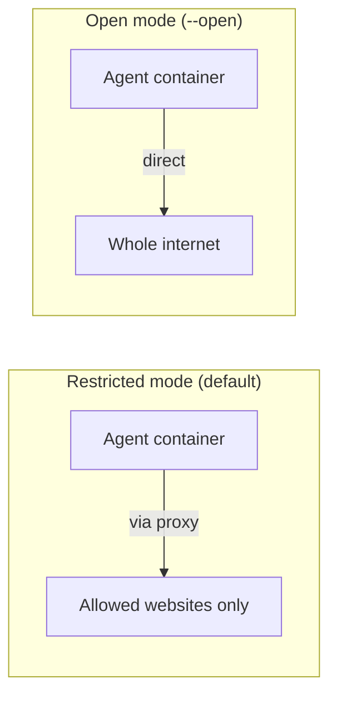

# Switch to restricted mode and test it

## Description

Start using the launcher's default **restricted mode**, where the container can reach the internet only through the allowlist proxy, and check that it works. You also confirm that **open mode** is still there for the times you need the whole web.

**There is nothing to edit in this step.** The launcher in your clone already contains everything (you reviewed it in Step 4). Until now you used it with `--open`, because the proxy didn't exist yet. Now it does.



## Before you start

- Step 5 is done: you logged in once, so your login is saved in the `claude-state` volume. You do **not** need to log in again.
- Step 7 is done: the `claude-proxy` container exists. (The launcher starts it for you if it is stopped.)
- Use the `~/sandbox-test` folder from earlier steps, or any empty test folder.

## Key terms

- **Restricted mode**: the default. The container sits on the internal network and reaches only the websites on the allowlist, through the proxy.
- **Open mode**: `claude-box --open`. The container has full internet access, and the launcher prints a warning.
- **Environment variable**: a named setting handed to a program when it starts. Here, `HTTPS_PROXY` tells programs which proxy to use.

## 8.1 What restricted mode does

You don't type anything here. When you run `claude-box` without `--open`, the launcher:

1. Checks that the proxy container exists, and starts it if it is stopped.
2. Looks up the proxy's address on the internal network (it can change after a restart, so it is looked up every time).
3. Puts your container on the internal network.
4. Sets the proxy variables, so Claude Code, curl and git send their traffic through the proxy.
5. Gives the container a DNS setting that goes nowhere, which closes the name-lookup leak you saw in Step 6.

The network options it adds:

| Option | What it does |
|---|---|
| `--network claude-internal` | Puts the container on the network with no route out |
| `HTTPS_PROXY` and `https_proxy` | Tell programs to send HTTPS traffic through the proxy. Both spellings are set because different tools read different ones |
| `--dns 127.0.0.1` | Points name lookups at the container itself, where nothing answers, so outside names don't resolve. The proxy is reached by address, so nothing needs a lookup |
| `CLAUDE_CODE_DISABLE_NONESSENTIAL_TRAFFIC=1` | Switches off Claude Code's optional telemetry, so it doesn't try to reach hosts that aren't on the allowlist |
| `ENABLE_CLAUDEAI_MCP_SERVERS=false` | Stops Claude Code from trying to load the connectors attached to your claude.ai account (see 8.6) |
| `CLAUDE_BOX_MODE=restricted` | A variable you can read inside the container to see which mode you are in |

## 8.2 Test restricted mode

```bash
cd ~/sandbox-test
claude-box
```

**Expected:** a shell prompt like `claude@abc123:/workspace/sandbox-test$`, and **no** warning line. (If you see `Proxy container 'claude-proxy' not found`, Step 7 isn't finished.)

Run each command inside the container and compare:

```bash
echo $CLAUDE_BOX_MODE
# Expected: restricted

env | grep -i proxy
# Expected: HTTPS_PROXY and https_proxy, both pointing at http://10.x.x.x:3128

curl -sS -m 15 -o /dev/null -w '%{http_code}\n' https://api.anthropic.com
# Expected: an HTTP status such as 404. It went through the proxy automatically.

curl -sS -m 15 -o /dev/null -w '%{http_code}\n' https://example.com
# Expected: "CONNECT tunnel failed, response 403" (blocked by the allowlist)

curl --noproxy '*' -sS -m 8 -o /dev/null -w '%{http_code}\n' https://api.anthropic.com
# Expected: a failure. Skipping the proxy gets you nowhere, because the network has no route out.

getent hosts example.com; echo "exit code: $?"
# Expected: nothing printed before the last line, then: exit code: 2
# (exit code 2 means "name not found", so the DNS leak is closed)

exit
```

Then read the proxy's log from your computer:

```bash
# Expected: allowed lines for api.anthropic.com and a DENIED line for example.com
podman exec claude-proxy tail -n 10 /var/log/squid/access.log
```

## 8.3 Test Claude Code in restricted mode

```bash
cd ~/sandbox-test
claude-box claude
```

**Expected:** Claude starts without asking you to log in, because the login is saved in the volume. Send a short message such as "say hello" and it should answer. Run `/status` to confirm your account.

If you see `Login expired · Please run /login` or a login prompt, run `/login` in the session. It works through the proxy, because `claude.ai` and `platform.claude.com` are on the allowlist.

Afterwards, check which hosts Claude used:

```bash
podman exec claude-proxy tail -n 15 /var/log/squid/access.log
```

You should see `api.anthropic.com` and probably `platform.claude.com` with `TCP_TUNNEL/200` (allowed).

## 8.4 Test open mode

```bash
cd ~/sandbox-test
claude-box --open
```

**Expected:** a `WARNING: OPEN MODE` line first, then a shell. Inside:

```bash
echo $CLAUDE_BOX_MODE
# Expected: open

env | grep -i proxy
# Expected: nothing

curl -sS -m 15 -o /dev/null -w '%{http_code}\n' https://example.com
# Expected: 200 (the whole web is reachable)

exit
```

`claude-box --open claude` runs Claude Code the same way.

**The tradeoff.** In open mode, anything running inside the container can send data anywhere, so the protection against data leaving your computer is off. Use it for projects you trust, and only while you need it. The next plain `claude-box` is restricted again, because the flag applies to one launch only.

## 8.5 Getting current documentation

In restricted mode, Claude can only fetch pages from allowlisted sites. For documentation you use regularly, add the domains to `proxy/allowlist.txt` and run `podman restart claude-proxy` (Step 7 shows how). For a one-off lookup on a site that isn't listed, use `claude-box --open`.

Claude's own page fetching from inside the container is expected to follow the same allowlist. If a fetch fails on a documentation site, look for a `TCP_DENIED` line for that site in the proxy log.

## 8.6 Reading the proxy log: what is denied, and why that's fine

After using Claude in restricted mode, the proxy log shows requests to a few hosts that are **not** on the allowlist, marked `TCP_DENIED/403`. Claude works normally anyway, so none of them has to be allowed.

| Host | What Claude Code uses it for | Decision |
|---|---|---|
| `downloads.claude.ai` | Plugin downloads and update version checks | Leave denied. Updates come from rebuilding the image, not from inside the container |
| `github.com` | Cloning plugin marketplaces at startup | Leave denied for now. GitHub accepts uploads, so it is a possible way to carry data out. Revisit it if you set up `git push` from inside the container |
| `mcp-proxy.anthropic.com` | Connectors attached to your claude.ai account | Already switched off by the launcher (`ENABLE_CLAUDEAI_MCP_SERVERS=false`), so you shouldn't see it |

**The rule behind the decisions:** every host you allow is a possible way out. Allow a host when something you actually need stops working, not because it appears in the log.

Long connection durations, around `300000` (milliseconds, about 5 minutes), are normal. Claude Code holds its connections open.

### If you do use claude.ai connectors in the sandbox

Remove the `-e ENABLE_CLAUDEAI_MCP_SERVERS=false` line from `bin/claude-box`, and allow the host instead:

```bash
echo "mcp-proxy.anthropic.com" >> ~/claude-sandbox/proxy/allowlist.txt
podman restart claude-proxy
```

### MCP servers you set up yourself

`mcp-proxy.anthropic.com` is only for connectors attached to your claude.ai account. An MCP server you configure yourself, such as a local one or a remote address set up in Claude Code, doesn't use it. A **remote** MCP server of your own needs its own domain in `proxy/allowlist.txt`. Decide that per project, when you add the server.

## Troubleshooting

| Symptom | Fix |
|---|---|
| `Proxy container 'claude-proxy' not found` | The proxy was never created or was removed. Repeat Step 7 (7.3) |
| `Could not find claude-proxy's address` | The proxy isn't attached to `claude-internal`. Check with `podman inspect claude-proxy --format '{{.NetworkSettings.Networks}}'` |
| `getent hosts example.com` still prints an address | The DNS setting didn't take effect. Copy the output of `cat /etc/resolv.conf` from inside the container |
| `curl` works but Claude Code fails to start or hangs | Look at the end of the proxy log for `TCP_DENIED` hosts, and copy those lines |
| Name lookups take several seconds to fail | Expected with the DNS setting: the lookup times out instead of failing at once. It doesn't affect Claude, which goes through the proxy |
| Claude asks you to log in again | Check that `podman volume ls` still shows `claude-state`. Nothing in this step touches it |
