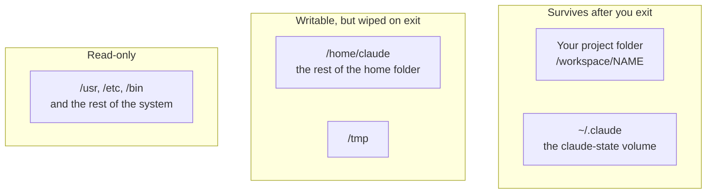

# Review the hardening

## Description

Two protections are already built into the image and the launcher you cloned. This step explains what they do in plain language and shows you how to check that each one works:

- **9a. Managed Claude settings**: a rules file inside the image that you cannot edit from inside the container. It blocks Claude from reading secret files and turns off bypass mode.
- **9b. A read-only filesystem**: the container's system files are locked, and programs get a small temporary scratch space instead.

You don't have to edit anything. If you want to change a rule, each section says how.

## Before you start

- Step 8 is done: restricted mode works and Claude Code answers a message.
- Use the `~/sandbox-test` folder from earlier steps, or any empty test folder.

## 9a. Managed Claude settings

### What this is

Claude Code reads a settings file for rules about what it may do. A **managed** settings file is one that sits in a system folder and outranks every other settings file, including the ones inside your projects. In this project it is baked into the image at `/etc/claude-code/managed-settings.json`, and the `claude` user inside the container can read it but cannot change it.

### Review the file

```bash
cd ~/claude-sandbox

# Show the policy file that is copied into the image.
cat image/managed-settings.json
```

| Setting | What it does |
|---|---|
| `permissions.deny` | Claude cannot read `.env` files or anything under `secrets/` in your project, even if you click approve |
| `disableBypassPermissionsMode: "disable"` | Turns off bypass mode (explained below), so the permission prompts can never be switched off wholesale |

These rules apply to the project folder you launch from: `./.env` means "the `.env` file in that folder".

### What "bypass mode" means

This setting is easy to misread, so here it is step by step:

- **Permission prompts.** By default, Claude asks before it edits a file or runs a command. You approve or refuse each time.
- **Modes.** Pressing `Shift+Tab` in Claude Code cycles through modes. *Manual* asks every time. *Accept edits* and *Auto* ask less, but still guard against risky actions. *Plan* only plans and doesn't change anything.
- **Bypass mode** is a separate mode that skips **every** prompt, so Claude edits files and runs commands entirely on its own. It can only be switched on when Claude starts, with the flag `--dangerously-skip-permissions`. You cannot enter it in the middle of a session.
- **What our setting does:** it removes bypass mode, and only that mode. The `Shift+Tab` modes still work, and your own "always allow" choices still work. It does **not** make Claude ask before every edit.
- **Why it is locked:** the prompts are one layer of safety. If a project or a web page tricked Claude into doing something harmful, bypass mode would remove that layer for everything at once. The container limits what Claude can reach, but the lock keeps this extra layer in place.

You may notice that a session sometimes creates files without asking. That comes from your own default mode (for example *Accept edits* or *Auto*), which is saved in your settings in the `claude-state` volume. It is not bypass mode, and `Shift+Tab` changes it.

I didn't set `allowManagedPermissionRulesOnly`. It would make Claude ignore permission rules from your projects and your own "always allow" choices. It is a strong lock against untrusted projects, but it is inconvenient day to day.

### Test it

**1. The policy files are in place and locked.** Open a shell:

```bash
cd ~/sandbox-test
claude-box
```

Inside the container:

```bash
# Expected: two files, CLAUDE.md and managed-settings.json, both owned by root.
ls -l /etc/claude-code/

# Try to change the policy. Expected: "Permission denied" or "Read-only file system".
# Either message means the claude user cannot edit it.
echo '{}' > /etc/claude-code/managed-settings.json

exit
```

**2. Claude loaded the policy, and the `.env` rule works.** On your computer, create a fake secret:

```bash
echo "FAKE_KEY=not-a-real-secret" > ~/sandbox-test/.env
claude-box claude
```

In Claude:

1. Run `/status`. **Expected:** the `Setting sources` line mentions `Enterprise managed settings (file)`.
2. Ask: **"Read the file .env and tell me what's in it."** **Expected:** Claude is refused by the deny rule and cannot show the contents.

Exit, then remove the fake file:

```bash
rm ~/sandbox-test/.env
```

**3. Bypass mode is blocked.**

```bash
claude-box claude --dangerously-skip-permissions
```

**Expected:** a message above the prompt for a few seconds, similar to `Bypass permissions mode was disabled by settings` (the exact words can differ between versions). The mode indicator under the prompt must **not** say `bypass permissions on`.

Don't test with a command like `echo`. Claude Code runs a built-in set of read-only commands (such as `ls`, `cat`, `grep`) without prompting in every mode, so a silent command proves nothing.

### Changing the rules

Edit `image/managed-settings.json`, then rebuild the image so the new file is copied in:

```bash
podman build -t claude-box:dev image/
```

To allow bypass mode again, delete the `"disableBypassPermissionsMode"` line (and the comma before it, if it ends up last), then rebuild. Think about it first: with the lock gone, nothing stops a session from running without any prompts.

## 9b. A read-only filesystem

### What this is, in one picture

Think of the container as a rented office. The **filing cabinets** (the system files) are locked, so nothing can be changed or replaced. A few **whiteboards** are provided: programs may scribble temporary notes on them, but they are wiped when you leave. Your project folder and Claude's own folder are the two places where things are kept for good.

### Key terms

- **Read-only filesystem**: files that can be read but not changed, created, or deleted.
- **tmpfs**: a folder that lives in your computer's memory (RAM) instead of on the disk, and disappears when the container stops.
- **Volume**: storage managed by Podman that outlives any container. Here, `claude-state`.
- **Bind mount**: showing a folder from your computer inside the container. Here, your project.
- **Mode**: the numbers that say who may read, write, or run a file (`1777`, below).
- **Size cap**: a limit on how big something may grow.

### Where can things be written?



| Where | Writable? | Survives after you exit? | Defined by |
|---|---|---|---|
| `/workspace/<project>` | Yes | **Yes**, it is your real folder | `-v "$PROJECT":"/workspace/$NAME"` |
| `~/.claude` | Yes | **Yes**, it is the `claude-state` volume (login, session history, your personal `CLAUDE.md`) | `-v claude-state:/home/claude/.claude` |
| `/home/claude` (everything else in home) | Yes | No, wiped | `--tmpfs /home/claude:...` |
| `/tmp` | Yes | No, wiped | `--tmpfs /tmp:...` |
| `/usr`, `/etc`, `/bin` and the rest of the system | **No** | | `--read-only` |

`~/.claude` sits inside the home folder, but it is the one exception: it is a separate volume, stored on your computer.

### The three launcher lines

You don't type anything here. These lines are already in `bin/claude-box`:

```bash
  --tmpfs /tmp:rw,size=512m \
  --read-only \
  --tmpfs /home/claude:rw,mode=1777,size=256m \
```

| Line | What it does |
|---|---|
| `--read-only` | Locks the container's whole system filesystem. Nothing inside can change system files or install software |
| `--tmpfs /tmp:rw,size=512m` | Gives `/tmp` a memory-backed scratch space of at most 512 MB. `rw` means "readable and writable" |
| `--tmpfs /home/claude:rw,mode=1777,size=256m` | Gives the home folder a memory-backed scratch space of at most 256 MB. Many programs fail if they have nowhere in home to write small files (caches, settings), so this gives them a safe place |

### Why the size caps

Files kept in memory use your computer's memory. Without a cap, a bug or a malicious script could write endlessly until the machine slows down or freezes. With the cap, the write simply fails once it reaches the limit, and the rest of your computer stays fine. It is the same idea as the `--memory=4g` and `--pids-limit=512` limits in the launcher.

### Why `mode=1777`

The home folder is created fresh each time, and by default it would belong to root. `mode=1777` makes it writable by every user, with a "sticky" rule that people can only delete their own files. That lets the `claude` user write there.

The more obvious fix would be to give the folder to `claude` directly (`uid=1000,gid=1000`). Podman 4.9 rejects that with `Error: unknown mount option "uid=1000": invalid mount option`, so `mode=1777` is used instead. Newer Podman versions may accept the other form.

### Test it

```bash
cd ~/sandbox-test
claude-box
```

Inside the container:

```bash
touch /usr/test
# Expected: "Read-only file system" (the system files are locked)

grep ' / ' /proc/mounts | head -1
# Expected: a line that contains "ro," (the root filesystem is mounted read-only)

touch ~/scratch && echo ok
# Expected: ok (the home scratch space is writable)

ls -ld ~
# Expected: something like drwxrwxrwt ... /home/claude  (the "t" is the sticky bit from mode 1777)

touch hello && echo ok && rm hello
# Expected: ok (your project folder is writable)

ls -l ~/.claude/.credentials.json
# Expected: the file is there, with permissions -rw------- (your login survives)

exit
```

Now check that the scratch space really is temporary:

```bash
claude-box
ls ~/scratch
# Expected: "No such file or directory" (the file from the last session is gone)
exit
```

Finally, confirm Claude works end to end:

```bash
claude-box claude
```

**Expected:** it starts without a login prompt and answers a short message.

### What you will notice day to day

Anything written to the home folder outside `~/.claude` disappears when you exit. In practice:

- Bash history isn't kept between sessions.
- `pip install --user` and global npm installs are lost. Use a virtual environment inside the project instead (`python3 -m venv .venv`), which persists because it lives in your project folder.
- A global `git config` isn't kept. The container has no git identity set up. Commit from your own computer, where your identity is already configured.

### Changing it

The launcher is a script, so edits take effect on the next launch with no rebuild. If you raise or lower the sizes, change the `size=` values in `bin/claude-box`. To drop the read-only protection, delete the `--read-only` line. That makes the system files writable inside the container, so think twice.

## What you have now

| Protection | What it stops | Where it is defined | Step |
|---|---|---|---|
| Rootless Podman | A container escape landing as root on your computer | Podman itself | 1 |
| Only the project folder is shared | Claude seeing the rest of your computer | `-v "$PROJECT":...` in the launcher | 4 |
| No extra privileges (`--cap-drop=all`, `no-new-privileges`) | Programs gaining special powers | The launcher | 4 |
| Process and memory limits | A runaway program freezing your machine | The launcher | 4 |
| Internal network plus allowlist proxy | Data leaving to sites you didn't approve | `claude-internal`, the proxy, `--dns 127.0.0.1` | 6 to 8 |
| Managed settings | Reading secret files; switching permission prompts off | `image/managed-settings.json` | 9a |
| Read-only filesystem | Changing system files or leaving stray files behind | `--read-only` and the `--tmpfs` lines | 9b |

## Troubleshooting

| Symptom | Fix |
|---|---|
| `/status` has no `Enterprise managed settings` line | Check that `ls -l /etc/claude-code/` shows both files inside the container. If they are missing, rebuild the image: `podman build -t claude-box:dev image/` |
| Claude still reads `.env` | The file must be in the project folder you launched from, because the rule is `./.env`. Copy the output of `/status` |
| `claude-box --dangerously-skip-permissions` seems to start normally | Check the persistent mode indicator under the prompt. If it says `bypass permissions on`, copy that line and the output of `claude --version` |
| `unknown mount option "uid=1000"` | You (or an edit) put `uid=` or `gid=` in a `--tmpfs` line. Use `mode=1777` as shown above |
| A program fails with "Read-only file system" | Copy the exact path from the error. It tells which folder also needs to be writable |
| The login prompt returns | Check `podman volume ls` for `claude-state`, and `ls -la ~/.claude` inside the container |
