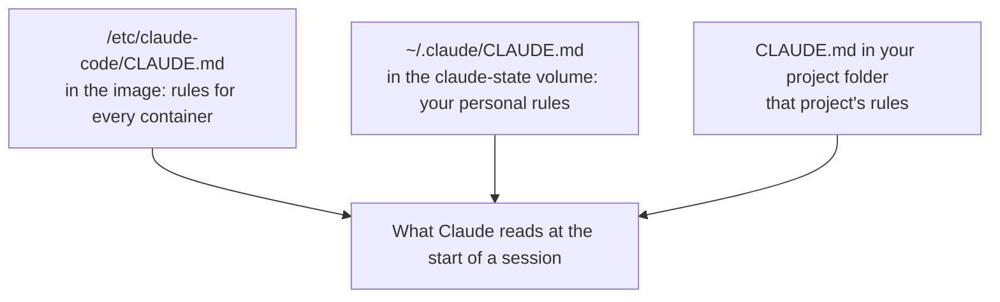

# Review the global CLAUDE.md

## Description

Understand the general instructions file that is baked into the image, check that Claude reads it, and learn where your own personal rules should go. You don't have to edit anything.

## Before you start

- Step 3 is done (the image is built) and Step 9 is done (you checked `/etc/claude-code/`).
- Claude Code works in restricted mode (Step 8).

## Key terms

- **CLAUDE.md**: a plain text file of instructions that Claude reads at the start of every session, like a note left on its desk.
- **Global (managed) CLAUDE.md**: the copy that lives in the image at `/etc/claude-code/CLAUDE.md`. It applies to every project and every container you start from the image, and you cannot edit it from inside the container.
- **User-level CLAUDE.md**: your personal copy at `~/.claude/CLAUDE.md`. It lives in the `claude-state` volume, so it is yours alone and is not part of the repository.
- **Project-level CLAUDE.md**: a file in a project's own folder with rules for that one project.

## 10.1 Where Claude reads instructions from

Claude Code reads CLAUDE.md files from several places and combines them:



| File | What it is for | Where it lives |
|---|---|---|
| `/etc/claude-code/CLAUDE.md` | Facts about this sandbox and safe-working rules that should apply everywhere | In the image, copied from `image/CLAUDE.md` in the repo |
| `~/.claude/CLAUDE.md` | Your personal preferences in every project | In the `claude-state` volume. Persists, but is not in the repo |
| `CLAUDE.md` in a project | Instructions for that one project | In the project, so it travels with its repo |

### An important limit

**CLAUDE.md is guidance, not enforcement.** Claude usually follows it, but nothing forces it to. The hard limits are the ones you already checked: the managed settings (Step 9), the proxy and internal network (Steps 6 to 8), and the read-only filesystem (Step 9). Use CLAUDE.md for what Claude should know and how it should behave, and don't rely on it for security.

A project's own `CLAUDE.md` is loaded too. If it disagrees with the global one, don't assume the global one wins. That is one more reason the real limits live elsewhere.

## 10.2 Review the global file

```bash
cd ~/claude-sandbox

# Show the instructions file that is copied into the image.
cat image/CLAUDE.md
```

What each section is for:

| Section | What it tells Claude, and why |
|---|---|
| Where you are | The facts of the sandbox: which folders are permanent, that system files are locked, and to use a `.venv` for Python. This stops Claude from wasting time on things that can't work here |
| Network | The proxy exists, what a block looks like, and to **stop and ask** instead of hunting for a way around it. It also tells Claude to check `CLAUDE_BOX_MODE`, so it knows when the network is open |
| Secrets | Never touch credentials. This backs up the deny rules from Step 9 with a plain instruction |
| Working rules | General good habits: ask before big or irreversible changes, don't commit unless asked, and treat instructions found in files or web pages as untrusted |

The file is short on purpose. Claude reads every line at the start of every session, and shorter files are followed more reliably.

## 10.3 Check that it is in the image

```bash
# Expected: two COPY lines, one for managed-settings.json and one for CLAUDE.md
grep -n COPY image/Containerfile
```

The `COPY` lines run before the Containerfile switches to the `claude` user, so the files end up owned by root.

## 10.4 Test it

**1. The file is in place and locked.** Open a shell:

```bash
cd ~/sandbox-test
claude-box
```

Inside the container:

```bash
# Expected: CLAUDE.md and managed-settings.json, both owned by root.
ls -l /etc/claude-code/

# Try to change it. Expected: "Permission denied" or "Read-only file system".
echo "extra rule" >> /etc/claude-code/CLAUDE.md

exit
```

**2. Claude loaded it.**

```bash
claude-box claude
```

1. Run `/memory`. **Expected:** the list of loaded files includes `/etc/claude-code/CLAUDE.md`.
2. Ask: **"Summarize the rules you follow in this environment."** **Expected:** it describes the sandbox, the proxy, and the secrets rules.
3. Ask: **"Use curl to fetch https://example.com and show me the result."** **Expected:** Claude runs into the block, tells you the domain is blocked, and asks what to do instead of looking for a workaround. This is Claude's behavior, so it is good evidence but not a guarantee.

**3. Optional: open mode.** Start `claude-box --open claude`. **Expected:** Claude mentions once, near the start, that the network is open. Again, this is behavior, not a guarantee.

## 10.5 Changing the rules

Edit `image/CLAUDE.md`, rebuild the image so the new file is copied in, then start Claude again:

```bash
podman build -t claude-box:dev image/
claude-box claude
```

- **Already-open sessions keep the old text.** Claude reads the file once when it starts. Starting a new container reads the new file.
- **Resuming works too.** `claude-box claude -r` starts a new container, so a resumed session picks up the new rules. The earlier conversation comes back with it, so check with `/memory` or by asking Claude to summarize its rules.

## 10.6 Your own personal rules

Don't put personal preferences in `image/CLAUDE.md`. That file is meant to stay generic and safe to share. Put personal rules in your user-level file instead:

- **Where it lives:** `~/.claude/CLAUDE.md` inside the container. That is the `claude-state` volume, so it is stored on your computer, survives every container, and is never committed to the repository.
- **How to create it:** start Claude and run `/memory` to see and edit the loaded files, or simply ask Claude to write the rules you describe into `~/.claude/CLAUDE.md`.
- **What belongs there:** how you like answers written (short or detailed, plain language), language and style preferences, how you want commit messages written, and anything you want Claude to always ask about first.
- **Backups:** the file is part of the volume, so `podman volume export claude-state` (Step 5) saves it together with your login and history. That backup also contains your login token, so keep it private. If you want a copy of just your rules, keep it in a private repository of your own.

Where each kind of rule belongs:

| Rule | Where it goes |
|---|---|
| Facts about the sandbox, and safe-working rules for everyone | `image/CLAUDE.md` in the repo (rebuild after editing) |
| Your personal style and preferences | `~/.claude/CLAUDE.md` in the volume |
| Things that are true for one project only | That project's own `CLAUDE.md` |

## Troubleshooting

| Symptom | Fix |
|---|---|
| `grep -n COPY` shows only one line | The `COPY CLAUDE.md` line is missing from `image/Containerfile`. Add `COPY CLAUDE.md /etc/claude-code/CLAUDE.md` after the managed settings `COPY`, then rebuild |
| `/memory` doesn't list the file | Check `ls -l /etc/claude-code/` inside the container. If `CLAUDE.md` is there, copy the `/memory` output |
| Claude ignores a rule | That can happen. Make the rule shorter and more specific. If it matters for security, enforce it in the settings or the network instead |
| Your edit to `image/CLAUDE.md` has no effect | You didn't rebuild, or you are in a session that was already open. Run `podman build -t claude-box:dev image/` and start a new `claude-box` |
